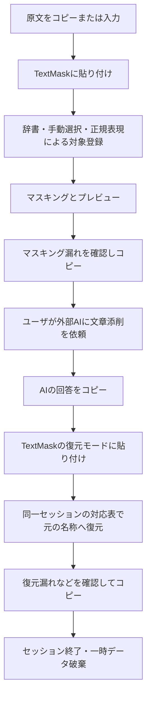

# TextMask — ローカル文章マスキング・復元ツール設計仕様書

> この文書は、Windows向けの軽量GUIアプリについての検討内容を、Claude Code、Codex等の他のAIへ引き継ぐためにまとめたものである。現時点では設計案であり、実装済みの仕様や確定したユーザ要件を示すものではない。

## 1. 背景・目的

ChatGPTやClaudeなどの外部AIサービスへ文章添削を依頼する際、文章に含まれる会社名、人名、所属組織名、製品名などの情報を、送信前にローカルPC上で別の文字列へ置換したい。

単なる伏せ字化ではなく、AIによる添削後に元の固有名詞へ復元できる仕組みを提供する。

### ユーザの要件

- Windows上で利用する軽量なGUIアプリであること。
- 会社名などの文字列をマスキングし、外部AIに文章添削などを依頼する際に利用できること。
- 普段はWindows Terminal等でPowerShellを利用しているため、その環境から扱いやすいことが望ましい。

### 設計上の推奨事項（未確定）

- 仮称は `TextMask` とする。
- 個人利用、プレーンテキストを初期対象とする。
- 外部AIへの送信はユーザ自身が行い、アプリはネットワーク通信を行わない。
- 可逆マスキング、辞書管理、クリップボード連携を中心に実装する。
- 初期版は常駐アプリとせず、必要なときに起動する。

## 2. 利用フロー



### 変換例

**原文**

```text
株式会社サンプルの田中様へ、新宿支店の件について確認をお願いします。
```

**マスキング後**

```text
[[COMPANY_01]]の[[PERSON_01]]様へ、[[PLACE_01]]の件について確認をお願いします。
```

**AIによる添削結果**

```text
[[COMPANY_01]]の[[PERSON_01]]様へ、[[PLACE_01]]の件につきまして、ご確認をお願いいたします。
```

**復元結果**

```text
株式会社サンプルの田中様へ、新宿支店の件につきまして、ご確認をお願いいたします。
```

AIの利用方法は特定サービスに依存させない。APIキー、API課金、ブラウザ拡張機能などは初期版には不要。

## 3. 技術選定

### 推奨構成

| 項目 | 推奨仕様 |
| --- | --- |
| 開発言語・実行環境 | PowerShell 7（Windows上） |
| GUI | .NET Windows Forms（WinForms） |
| 主な起動方法 | PowerShellコマンド `mask` |
| 実行スレッド | STA（GUI・クリップボード操作のため） |
| 変換方式 | 辞書によるリテラル置換、必要に応じて正規表現 |
| 永続データ | JSON相当の構造、機密辞書はDPAPIで暗号化 |
| 一時データ | プロセスのメモリ上 |
| AI連携 | クリップボード経由 |
| ネットワーク通信 | なし |
| 初期版の常駐 | なし（作業中はウィンドウを保持できる） |

PowerShellから以下の.NETアセンブリを読み込んでGUIを構築する。

```powershell
Add-Type -AssemblyName System.Windows.Forms
Add-Type -AssemblyName System.Drawing
```

GUI起動例（パスは環境に応じて変更する）：

```powershell
pwsh -NoProfile -STA -File "$HOME\Tools\TextMask\TextMask.ps1"
```

### 他の選択肢との比較

| 技術 | 特徴・採否 |
| --- | --- |
| PowerShell + WinForms | 追加環境や配布手順が比較的少なく、今回の初期版に推奨 |
| PowerShell + WPF | デザインやデータバインディングに柔軟性があるが、初期版にはやや複雑 |
| C# + WinForms | 独立した実行ファイル、タスクトレイ常駐、ホットキー等の拡張時に有力 |
| C# + WPF | リッチなWindowsデスクトップUIへ発展させる場合の候補 |
| Python + Tkinter | 開発は比較的容易だが、Python環境や配布方法を別途考慮する必要がある |
| Tauri | Web技術でUIを実装できるが、今回の規模では開発環境が大きくなりやすい |
| Electron | Web技術で実装可能だが、軽量性を優先する今回の初期版には不向き |

PowerShellは実装の推奨案であり、既存ユーザ環境や保守性を考慮してC#へ変更する余地は残す。実際の起動時間やメモリ消費量の比較測定は未実施。

## 4. GUI設計

### 4.1 レイアウト案

1つのウィンドウで基本操作を完結させる。

```text
+------------------------------------------------------------------+
| TextMask                                           [設定] [_][X] |
+------------------------------------------------------------------+
| [マスキング] [復元]                     プロファイル: [default v] |
+--------------------------------+---------------------------------+
| 入力文章                       | 変換結果                        |
|                                |                                 |
| 株式会社サンプルの田中様       | [[COMPANY_01]]の[[PERSON_01]]様 |
| ...                            | ...                             |
|                                |                                 |
+--------------------------------+---------------------------------+
| [貼り付け] [選択範囲を登録]       [変換] [変換してコピー]        |
+------------------------------------------------------------------+
| マスキング辞書                         [追加] [編集] [削除]     |
| 元の文字列       | 置換文字列          | 種別   | 出現件数      |
| 株式会社サンプル | [[COMPANY_01]]      | 永続   | 1             |
| 田中             | [[PERSON_01]]       | 一時   | 1             |
+------------------------------------------------------------------+
| ローカル処理 / マスキング件数: 2 / 警告: なし                    |
+------------------------------------------------------------------+
```

### 4.2 操作要件

- 入力欄：複数行のプレーンテキストを貼り付け・編集できる。
- 出力欄：変換結果を表示する。原則読み取り専用とし、必要に応じて選択・コピーできる。
- マスキング／復元モードを切り替えられる。
- 入力文章の一部をマウスで選択し、そのまま辞書へ登録できる。登録時にカテゴリ、一時／永続の種別を選べる。
- 辞書の追加、編集、削除ができる。
- 変換結果を確認してからクリップボードへコピーできる。`変換してコピー` でも同一の検証処理を実施する。
- 変換対象のハイライトと出現件数を表示することが望ましい。
- ステータス欄に変換件数、警告、エラーを表示する。
- 日本語IME、Unicode、複数行の入力、ウィンドウのリサイズに対応する。

WinFormsでは `RichTextBox`、`DataGridView`、`TableLayoutPanel` 等を利用する案が考えられる。具体的な寸法、テーマ、配色は未決定。

## 5. 機能要件と優先順位

| ID | 機能 | 優先度 | 概要 |
| --- | --- | --- | --- |
| F01 | マスキング | 必須 | 辞書に基づく文字列の一括置換 |
| F02 | 復元 | 必須 | 同じ対応表で識別子を元の文字列へ戻す |
| F03 | クリップボード連携 | 必須 | 文章の貼り付け、変換結果のコピー |
| F04 | 辞書管理 | 必須 | 置換対象の登録・編集・削除 |
| F05 | 選択範囲からの登録 | 高 | 入力欄の選択文字列を直接登録 |
| F06 | ハイライト・件数表示 | 高 | 変換箇所や漏れを目視確認 |
| F07 | 正規表現による検出 | 高 | メールアドレス・電話番号等を候補化 |
| F08 | 一時辞書・セッション管理 | 高（復元に必要な部分は必須） | 今回の作業だけの対応表を保持 |
| F09 | プロンプト付加 | 高 | AIへ識別子を維持するよう指示 |
| F10 | プロファイル管理 | 中 | 仕事用・研究用・プライベート用の辞書を分離 |
| F11 | グローバルホットキー | 中 | 他アプリからの起動 |
| F12 | CLIによる変換 | 中 | GUIなしで変換するモード |
| F13 | 固有表現の自動検出 | 低 | 未登録の人名・会社名などの候補検出 |
| F14 | タスクトレイ常駐 | 低 | 常駐ユーティリティ化 |

## 6. マスキング方式

### 6.1 識別子の形式

すべてを `XXX` に置き換えるのではなく、カテゴリと通し番号を持つ識別子を使用する。AIに意味上の役割を残し、異なる対象を区別しながら復元できるようにする。

| カテゴリ | 識別子例 |
| --- | --- |
| 会社名・組織名 | `[[COMPANY_01]]` |
| 人名 | `[[PERSON_01]]` |
| 地名・拠点名 | `[[PLACE_01]]` |
| 製品名 | `[[PRODUCT_01]]` |
| プロジェクト名 | `[[PROJECT_01]]` |
| メールアドレス | `[[EMAIL_01]]` |
| 電話番号 | `[[PHONE_01]]` |
| その他 | `[[CUSTOM_01]]` |

同一セッション内では同じ原文字列に同じ識別子を割り当てる。異なる原文字列には異なる識別子を割り当てる。敬称（`様`、`さん`など）は必要に応じて元の文章に残す。

### 6.2 置換エンジンの設計

以下は前回の方針を実装可能な形に具体化した推奨ルールである。

1. セッションに適用する辞書を読み込み、空文字列・重複・対応表の衝突を検証する。
2. 置換対象が重なる場合は、原則として同じ開始位置にある長い文字列を優先する。その他の重複についても規則を固定してテストする。
3. 原文に対して一度の左から右への走査、またはリテラルをエスケープした正規表現とマッチ評価関数を使用する。単純な逐次置換による連鎖置換は避ける。
4. 既存の識別子と新規発行する識別子が衝突しないよう検証する。発行済みの識別子は再置換しない。
5. 置換結果、出現件数、警告、実際に使用した対応表を返す。
6. 復元時は、一般的な文字列置換の逆順実行ではなく、識別子をキーとした対応表を参照する。

例えば `株式会社サンプル` と `サンプル` が同時に登録されている場合、前者の内部だけを先に置換してしまわない設計にする。

- 初期版のリテラル検索は大小文字を厳密に区別する案とする。PowerShellの `-replace` が既定で大小文字を区別しない点に注意する。
- 正規表現のメタ文字を含む会社名なども、通常辞書ではリテラルとして処理する。
- 日本語の部分一致による過剰マスキングを考慮し、プレビューを必須とする。
- 改行、空白、句読点、全角・半角などは、マスキング対象部分以外について極力変更しない。

### 6.3 正規表現による検出

初期の拡張対象は、メールアドレスと電話番号とする。URL、郵便番号、IPアドレス等は必要に応じて追加する。

検出された値は、それぞれ固有の識別子に割り当て、セッションの対応表へ追加する。複数の異なるメールアドレスを単一の識別子へ置換してはいけない。

誤検出があり得るため、候補の確認・取り消しができるとよい。正規表現の実行時間制限も設けることを推奨する。

### 6.4 復元時の検証

外部AIは識別子を省略、改変、重複することがある。次の事象を警告対象とする。

- 現在の対応表に存在しない識別子。
- マスキング時に存在したが回答から消失した識別子。
- 出現回数が変化した識別子（文章再構成により正常に変化することもあるため警告扱い）。
- 識別子の書式が破損している可能性がある箇所。

未知または不正な識別子を推測で別の固有名詞に復元しない。原則として未解決の識別子はそのまま残し、ユーザに確認を求める。あらゆる破損・欠落を自動検知できるとは限らない。

## 7. AIへの添削プロンプト

任意で、マスキング済み文章へ以下の指示を自動付加できるようにする。

```text
以下の文章を添削してください。
ただし、[[COMPANY_01]] などの二重角括弧で囲まれた識別子は、変更・省略せず、そのまま維持してください。
添削後の文章のみを出力してください。

【添削対象】
（マスキングされた文章）
```

通常の結果コピーとプロンプト付きコピーを分けるかどうかは未確定。外部AIに指示しても識別子が必ず保持されるわけではないため、復元時の検証は別途実施する。

## 8. 辞書・セッション管理

### 8.1 辞書の種類

| 種類 | 用途 | 保管方法 |
| --- | --- | --- |
| 永続辞書 | 頻繁に出現する会社名や組織名など | ローカルに暗号化保存 |
| 一時辞書 | 今回だけ使う人名や固有名詞 | メモリ上のみ |
| セッション対応表 | 実際の変換で発行した識別子と原文字列の対応 | デフォルトでメモリ上のみ |

セッション対応表は、辞書の設定とは分離する。辞書が後から編集されても、既にAIへ送信した文章の復元先が変化しないようにする。

### 8.2 JSONの構造例

前回の設計では元の文字列と置換文字列をJSONで管理する案を提示した。実装時は、辞書設定とセッション対応表を分離し、識別子をセッションごとに割り当てる方式を推奨する。

永続辞書の暗号化前の論理構造例（実際の保存ファイルは平文にしない）：

```json
{
  "schemaVersion": 1,
  "profile": "default",
  "entries": [
    {
      "original": "株式会社サンプル",
      "category": "COMPANY",
      "enabled": true
    },
    {
      "original": "田中",
      "category": "PERSON",
      "enabled": true
    }
  ]
}
```

セッション対応表の論理構造例（メモリ上）：

```json
{
  "sessionId": "example-session",
  "profile": "default",
  "mappings": [
    {
      "original": "株式会社サンプル",
      "replacement": "[[COMPANY_01]]",
      "count": 1
    },
    {
      "original": "田中",
      "replacement": "[[PERSON_01]]",
      "count": 1
    }
  ]
}
```

### 8.3 セッションのライフサイクル

- AIへ文章を送信した後も、復元するまではTextMaskのウィンドウ（またはセッション保持プロセス）を終了しない。
- マスキング／復元の画面切り替えでは対応表を破棄しない。
- 作業終了または明示的なセッションリセットで一時辞書・対応表を解放する。
- アプリを終了するとデフォルトではセッションが失われる。その場合、別プロセスでの復元は保証しない。
- MVPでは単一アクティブセッションを想定する。別の原文を処理する際は、対応表を不用意に上書きしないよう警告する。
- 複数セッション、暗号化されたセッションの保存・再開は将来拡張候補とする。

プロファイルは `default`、`work`、`research`、`personal` などを想定するが、初期版は単一プロファイルでもよい。

## 9. PowerShellとの連携

### 9.1 起動方法

`$PROFILE` に次のような関数を登録し、任意のディレクトリから起動可能にする案とする。

```powershell
function mask {
    pwsh -NoProfile -STA -File "$HOME\Tools\TextMask\TextMask.ps1" @args
}
```

この例は専用の子プロセスでGUIを起動する。PowerShellに制御が戻るのは通常ウィンドウ終了時となるため、必要であれば別プロセスへの非同期起動を追加する。PowerShellのプロファイルを自動改変するのではなく、READMEに登録手順を記載する。

### 9.2 コマンド体系案

| コマンド | 動作 | 備考 |
| --- | --- | --- |
| `mask` | GUIを起動 | 初期版 |
| `mask -Clipboard` | クリップボードを読み込んで起動 | 初期版または拡張 |
| `mask -Restore` | 復元画面で起動 | 対応表の引継ぎ機構がある場合のみ有効 |
| `mask -Profile work` | 指定したプロファイルで起動 | プロファイル対応後 |
| `mask -Silent` | GUIなしで変換しコピー | 将来拡張。復元に必要な対応表の保持と漏えい対策が前提 |

`mask -Restore` で新規プロセスを起動するだけでは、別プロセスの一時対応表を参照できない。初期版ではGUI内部の復元モードを基本とし、独立起動による復元はセッション共有・保存機構を別途設計してから実装する。

### 9.3 ショートカットキー案

| キー | 動作 |
| --- | --- |
| `Ctrl+Enter` | 変換してコピー |
| `Ctrl+D` | 入力欄の選択文字列を辞書へ登録 |
| `Esc` | ウィンドウを閉じる（未復元のセッションがあれば確認） |
| `Win+Shift+M` | マスキング画面を起動（将来） |
| `Win+Shift+R` | 復元画面を起動（将来） |

グローバルホットキーはAutoHotkeyまたはWindows APIによる実装を候補とする。Windowsや既存アプリのショートカットと競合する可能性があるため、実環境での確認が必要。キーは確定していない。

## 10. セキュリティ・プライバシー要件

本アプリ自体がマスキング前の機密情報を扱うため、以下を設計方針とする。

- 外部API、クラウド、テレメトリ、オンライン辞書等への通信を行わない。
- 入力文章、変換履歴、復元結果をデフォルトでファイルに保存しない。
- 永続辞書はWindows DPAPI（`CurrentUser` スコープを想定）で暗号化する。暗号化・復号失敗時に平文保存へフォールバックしない。
- 一時辞書とセッション対応表は原則メモリ上に保持する。PowerShell/.NETの文字列を使用するため、メモリからの完全消去を保証するものではない。
- 実際の機密文章や辞書はGit管理対象に含めない。テストは架空のデータのみを使用する。
- ログ、例外メッセージ、標準出力などに原文や対応表を出力しない。
- 機密データをコマンドライン引数として渡す設計を避ける（PowerShell履歴等への残留を防ぐ）。
- Windowsのクリップボード履歴・クラウド同期に注意する。アプリによる書き込みには、可能であれば `CanIncludeInClipboardHistory`、`CanUploadToCloudClipboard` 等のWindows定義の形式を使い、履歴・同期への追加を抑制する。実環境で検証する。
- アプリが制御できるのは自身の書き込みのみであり、他アプリで先にコピーされた原文、過去の履歴、サードパーティ製クリップボード監視ツール等は制御できない。必要に応じてOS側のクリップボード履歴・同期を無効化する。
- セッションを終了してもクリップボードに残るデータがある点に注意する。自動消去は既存のユーザデータを失う可能性があるため、明示的な操作または選択可能な設定とする。

### セキュリティ上の限界

TextMaskは可逆的な仮名化・秘匿化を補助するツールであり、完全匿名化や情報漏えい防止を保証するものではない。名称を削除しても、事業内容、数値、取引関係、役職、製品の特徴などの文脈から対象を再識別できる可能性がある。組織の情報管理規程で外部AIへの入力が禁止されている情報は、マスキングを理由に送信可能と判断してはならない。

DPAPIも、同一ユーザ権限で動作する悪意のあるプロセスや、侵害されたOSへの対策を保証しない。

## 11. プロジェクト構成案

```text
TextMask/
├── TextMask.ps1                  # エントリポイント・引数処理
├── modules/
│   ├── MaskEngine.psm1           # マスキング・復元・検証
│   ├── Dictionary.psm1           # 辞書管理とDPAPI保存
│   ├── Clipboard.psm1            # クリップボード操作
│   └── GUI.psm1                  # WinForms UI・イベント処理
├── tests/
│   ├── MaskEngine.Tests.ps1
│   └── Dictionary.Tests.ps1
├── .gitignore
└── README.md
```

必要に応じて `Session.psm1` を追加し、セッション管理を独立させる。

実行時データはリポジトリ外のユーザ固有ディレクトリに保存する。

```text
%LOCALAPPDATA%\TextMask\
├── settings.json                 # 機密情報を含まないUI設定等
└── profiles\
    ├── default.dat                # DPAPIで暗号化した辞書
    └── work.dat
```

GUIと置換ロジックを分離し、GUIを起動せずに置換エンジンをテスト可能な構造にする。将来的なCLI追加やC#への移行も考慮する。

## 12. 実装計画

### Phase 1：MVP

- PowerShell + WinFormsによる単一ウィンドウのGUI。
- 入力・出力テキスト欄、マスキング／復元モード。
- 手動辞書登録、編集、削除とセッション対応表。
- 辞書ベースの一括変換、識別子からの復元。
- 変換プレビュー、基本的な件数・警告表示。
- クリップボードへの貼り付け／コピー、`mask` コマンドによる起動。
- メモリ上の一時辞書。永続保存を提供する場合は初めから暗号化を実装する。
- 置換エンジンの単体テスト。

### Phase 2：操作性・検出機能の改善

- 選択範囲からの登録とマスキング箇所のハイライト。
- DPAPIによる永続辞書（Phase 1で未対応の場合）。
- 正規表現によるメールアドレス、電話番号等の検出。
- AIへの指示文付加、プロファイル切り替え。
- クリップボード履歴・同期の抑制機構の検証・強化。

### Phase 3：必要に応じた拡張

- グローバルホットキー、タスクトレイ常駐。
- CLI・パイプライン対応（機密データの出力やセッション管理に留意）。
- 複数セッションの管理、必要なら暗号化したセッションの保存・再開。
- オフライン日本語固有表現抽出（NER）によるマスキング候補の提示。
- 機能や保守性の要求が増大した場合はC# + WinFormsへの移行を検討。

## 13. テスト・受け入れ基準

PowerShellのPesterによる単体テストを推奨する。最低限、以下のケースを確認する。

| テストケース | 期待結果 |
| --- | --- |
| 会社名、人名の基本置換 | 指定された識別子へ変換できる |
| 同一原文字列が複数回出現 | 同じ識別子となり、出現件数が正しい |
| 別の会社名・人名が混在 | 別々の識別子が発行される |
| 長短の重複する辞書項目 | 定めた優先順位で一意に変換される |
| メタ文字を含む原文字列 | 通常辞書では文字どおり一致した部分を置換する |
| 原文に識別子と同形式の文字がある | 衝突を検知し、誤復元を防止する |
| 変換・復元の往復 | AI等による編集なしでは元の文章と一致する |
| AIが文章の順序を変更 | 識別子単位で正しく復元できる |
| 識別子の欠落・改変・追加 | 検出可能なものを警告し、未知識別子を誤復元しない |
| マスキング後に辞書を編集 | 発行済み対応表に基づいて復元できる |
| 空入力・辞書ゼロ件 | クラッシュせず適切に処理する |
| 日本語・複数行・全角半角 | 対象外の文字や改行を保持する |
| セッション終了 | 一時情報がアプリの状態から解放される |
| 暗号化辞書の再起動・読み込み | 同一ユーザで復号でき、保存ファイルに原文字列が平文で残らない |
| クリップボードが使用中 | エラーを通知し、必要なら制限付きで再試行する |
| ネットワーク接続なし | 主要機能が動作する |

Windows上でのGUI起動、STA動作、IME入力、クリップボード、DPAPIについては実機テストを行うこと。

## 14. 仕様の未確定事項・実装時の注意

- アプリ名、PowerShell + WinFormsの採用、GUIレイアウトは推奨案であり、ユーザの最終承認は得ていない。
- 今回の要件からは、実行ファイル化や管理者権限を必要とするインストーラは不要と判断したが、配布形態は未確定。
- ユーザのPowerShellのバージョン、Windowsのバージョン、利用可能な.NET環境は未確認。
- 初期版では日本語固有表現の完全自動検出は行わず、手動登録と辞書を優先する。
- 識別子のセッション単位採番、対応表の固定、同時に扱えるセッション数などは、元の構想を安全に実装するための補足設計案である。
- 識別子の文字形式、正規表現、重複時の具体的な優先規則、辞書保存のスキーマは実装時に検証が必要。
- メモリ消費量、起動時間の数値目標は未設定。常駐サービスや大規模な実行環境を必要としない構成を優先する。
- この文書には実装コード一式は含まれていない。Windows上での動作確認も未実施。

## 15. 参考資料（実装時の確認先）

- Microsoft Learn: [PowerShellでカスタム入力ボックスを作成する](https://learn.microsoft.com/powershell/scripting/samples/creating-a-custom-input-box)
- Microsoft Learn: [Windows Forms](https://learn.microsoft.com/dotnet/desktop/winforms/)
- Microsoft Learn: [ProtectedDataクラス（DPAPI）](https://learn.microsoft.com/dotnet/api/system.security.cryptography.protecteddata)
- Microsoft Learn: [Clipboard Formats](https://learn.microsoft.com/windows/win32/dataxchg/clipboard-formats)
- Microsoft Learn: [about_Pwsh](https://learn.microsoft.com/powershell/module/microsoft.powershell.core/about/about_pwsh)

上記は技術調査・API仕様確認のための公式ドキュメントへの参照先であり、この文書の作成時に各ページの最新版の再確認は行っていない。

## 16. 他のAIへの引き継ぎ指示例

この文書を読み込み、TextMaskの開発を行う場合は次の方針を優先する。

1. まず既存のリポジトリ、PowerShellのバージョン、実行環境を確認する。
2. MVPを優先し、未確定の仕様は必要最小限の合理的な仮定を置いて、README等に記録する。
3. GUIより先に、マスキング・復元・衝突検出を行うテスト可能な置換エンジンを実装する。
4. GUIと辞書管理、セッション管理、クリップボード操作を分離する。
5. 機密情報を外部へ送信しない設計を維持し、AI API連携やオンライン固有表現抽出を勝手に追加しない。
6. 一時対応表の寿命と、独立プロセスからは復元できない点を考慮する。
7. 永続化する機密辞書は暗号化し、テストとコミットにはダミーデータのみ使用する。
8. 実装後はテスト結果、Windows実機で未検証の項目、仕様からの変更点を報告する。

最初の目標は、PowerShellから軽量GUIを起動し、会社名などを辞書へ登録、マスキング結果をクリップボードへコピー、外部AIによる添削結果を同一セッション内で復元する一連の操作を実現することである。
